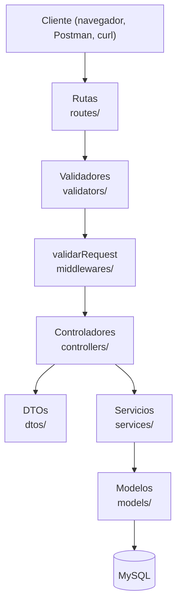
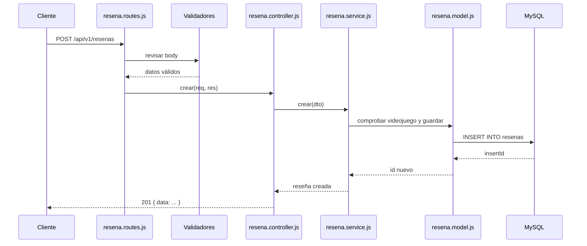

# Arquitectura del proyecto

## ¿Qué es?

La arquitectura describe **cómo se organiza el código** en carpetas y en responsabilidades. Este proyecto usa una **arquitectura por capas**: cada capa tiene un solo trabajo y solo habla con la capa inmediatamente inferior.

## ¿Por qué separar en capas?

Si todo el código viviera en un solo archivo, cambiar una regla (por ejemplo, la forma de guardar una reseña) obligaría a tocar rutas, validaciones y SQL al mismo tiempo. Con capas:

- Cada archivo es pequeño y tiene un nombre que dice qué hace.
- Puedes cambiar la base de datos sin tocar las rutas.
- Puedes probar la lógica de negocio sin levantar un servidor HTTP.
- Varias personas pueden trabajar en capas distintas sin pisarse.

## Analogía: un restaurante

| Pieza del restaurante                       | Equivalente en el código                  |
| ------------------------------------------- | ----------------------------------------- |
| La carta con los platos disponibles         | Rutas (`routes/`)                         |
| El cliente que hace el pedido               | La petición HTTP                          |
| El filtro que revisa el pedido              | Validadores (`validators/`)               |
| El mesero que toma el pedido y lo entrega   | Controladores (`controllers/`)            |
| El chef que decide cómo se prepara          | Servicios (`services/`)                   |
| La despensa donde están los ingredientes    | Modelos (`models/`) y la base de datos    |
| El formulario que solo deja pasar lo permitido | DTOs (`dtos/`)                         |

## Diagrama de capas



## Diagrama de una petición

Ejemplo: crear una reseña con `POST /api/v1/resenas`.



## Estructura de carpetas

```
src/
├── app.js            Configura Express
├── server.js         Arranca el servidor
├── config/           Conexión a la base de datos
├── routes/           Endpoints
├── validators/       Reglas de entrada
├── middlewares/      Funciones intermedias
├── controllers/      Manejo de req y res
├── dtos/             Campos permitidos
├── services/         Lógica de negocio
├── models/           SQL
├── constants/        Catálogos (plataformas, géneros, estados)
└── utils/            Utilidades (HttpError)
```

## Reglas de oro

1. **El controlador no escribe SQL** ni decide reglas de negocio.
2. **El servicio no conoce `req` ni `res`**, así puede usarse desde cualquier sitio.
3. **El modelo no conoce HTTP**: solo recibe datos y devuelve filas.

## Errores asíncronos en Express 5

Casi todas las funciones del proyecto usan `async`/`await`. En Express 5, si una función asíncrona lanza un error o su promesa se rechaza, Express lo envía automáticamente al middleware de errores. Por eso los controladores no necesitan `try/catch`.

## Ejercicio

Abre `src/routes/resena.routes.js` y sigue la ruta `POST /`. Anota qué archivo se ejecuta en cada paso hasta llegar a la base de datos. Compáralo con el diagrama de secuencia.
