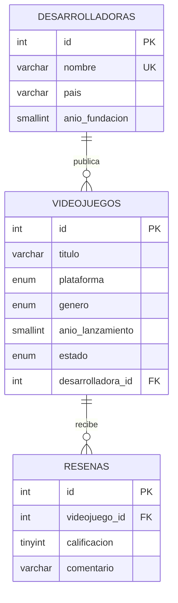

# Base de datos

Este documento explica las tres tablas de `database/schema.sql`, cómo se relacionan y por qué se definieron así.

## Diagrama entidad-relación



Lectura del diagrama: `||--o{` significa "uno a muchos". Una desarrolladora puede publicar muchos videojuegos, y un videojuego puede tener muchas reseñas.

## Las tres tablas

### 1. `desarrolladoras`

Guarda los estudios que crean los juegos. El campo `nombre` es `UNIQUE`: MySQL no permite dos desarrolladoras con el mismo nombre.

### 2. `videojuegos`

Es la tabla central. Tiene dos tipos de datos:

- **Datos propios:** `titulo`, `plataforma`, `genero`, `anio_lanzamiento`, `estado`.
- **Relación:** `desarrolladora_id` apunta a `desarrolladoras.id`. Puede ser `NULL`, porque un juego puede no tener estudio registrado.

### 3. `resenas`

Cada reseña pertenece a un videojuego. La columna `calificacion` tiene una regla `CHECK` que obliga a estar entre 1 y 5.

## Claves foráneas y qué pasa al borrar

Una clave foránea (FK) garantiza que no existan referencias rotas. La opción `ON DELETE` decide qué ocurre cuando se borra la fila padre.

| Relación                           | Opción       | Qué ocurre al borrar el padre                                  |
| ---------------------------------- | ------------ | -------------------------------------------------------------- |
| videojuego → desarrolladora        | `SET NULL`   | El juego se conserva, pero queda sin desarrolladora            |
| reseña → videojuego                | `CASCADE`    | Las reseñas del juego se borran automáticamente                |

Esta decisión es de negocio: un juego no debería desaparecer porque se borró su estudio, pero una reseña no tiene sentido sin su juego.

## Tipos de datos y restricciones

| Restricción                    | Dónde                          | Para qué sirve                                       |
| ------------------------------ | ------------------------------ | ---------------------------------------------------- |
| `PRIMARY KEY` + `AUTO_INCREMENT` | `id` en las tres tablas      | Identificador único que MySQL asigna solo            |
| `NOT NULL`                     | Campos obligatorios            | Impide guardar filas incompletas                     |
| `UNIQUE`                       | `desarrolladoras.nombre`       | Evita nombres repetidos                              |
| `ENUM`                         | `plataforma`, `genero`, `estado` | Solo acepta valores de una lista cerrada           |
| `CHECK`                        | `resenas.calificacion`         | Regla de rango (1 a 5)                               |
| `INDEX`                        | `estado`, `genero`, `videojuego_id` | Acelera búsquedas y filtros                     |
| `DEFAULT`                      | `estado`, `created_at`         | Valor automático si no se envía                      |

## ¿Por qué ENUM y no otra tabla?

Usar `ENUM` es sencillo y rápido para listas pequeñas y estables. Si mañana quisieras administrar los géneros desde la API, lo correcto sería crear una tabla `generos` con una clave foránea. Es un buen ejercicio de evolución del proyecto.

Las listas deben coincidir en tres lugares: el `ENUM` de `schema.sql`, el archivo `src/constants/catalogos.js` y los validadores. Si cambias una, cambia las tres.

## Columnas de auditoría

`created_at` y `updated_at` se llenan solos. `updated_at` usa `ON UPDATE CURRENT_TIMESTAMP`, así que MySQL lo actualiza en cada cambio sin que el código lo haga.

## Comandos útiles para explorar la base de datos

```sql
USE games_api;
SHOW TABLES;
DESCRIBE videojuegos;

-- Juegos con el nombre de su desarrolladora (JOIN)
SELECT v.titulo, d.nombre AS desarrolladora
FROM videojuegos v
LEFT JOIN desarrolladoras d ON d.id = v.desarrolladora_id;
```

## Ejercicio

Intenta insertar una reseña con `calificacion = 7` desde MySQL. Observa el error del `CHECK`. Después, borra un videojuego y verifica que sus reseñas desaparecen.
