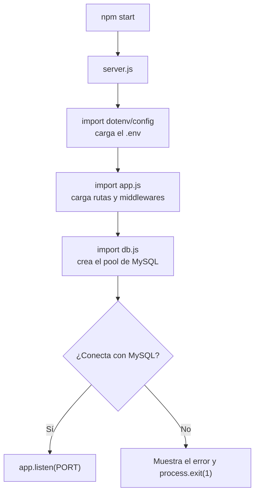

# Configuración: variables de entorno, base de datos, servidor y app

Esta sección explica cómo arranca la aplicación, desde que ejecutas `npm start` hasta que el servidor responde.

## Variables de entorno (`.env`)

Las credenciales y datos que cambian según el entorno (tu PC, un servidor de pruebas, producción) **no se escriben en el código**. Se guardan en un archivo `.env`:

```
APP_PORT=3000
DB_HOST=127.0.0.1
DB_PORT=3306
DB_NAME=games_api
DB_USER=root
DB_PASSWORD=tu_contraseña
```

- `.env.example` es una plantilla que sí se sube a GitHub, sin contraseñas.
- `.env` es tu archivo real, y `.gitignore` lo excluye para que nunca se publique.

La librería **dotenv** lee el `.env` y lo carga en `process.env`, un objeto global de Node.js con las variables del entorno. Por eso el código usa `process.env.DB_HOST`.

## Orden de arranque



El orden importa: `dotenv/config` debe ejecutarse antes de que se cree el pool, porque el pool lee las variables al crearse. Por eso aparece primero en `server.js` y también al inicio de `db.js`.

## `src/config/db.js`: el pool de conexiones

```js
const db = mysql.createPool({
  host: process.env.DB_HOST,
  port: Number(process.env.DB_PORT),
  database: process.env.DB_NAME,
  user: process.env.DB_USER,
  password: process.env.DB_PASSWORD,
  waitForConnections: true,
  connectionLimit: 10,
});
```

- **Pool:** en vez de abrir y cerrar una conexión por cada petición (lento), se mantiene un grupo de hasta 10 conexiones reutilizables.
- `Number(process.env.DB_PORT)`: las variables de entorno siempre son texto, así que el puerto se convierte a número.
- `waitForConnections: true`: si las 10 conexiones están ocupadas, la petición espera en lugar de fallar.

## `src/server.js`: el punto de entrada

```js
const conexion = await db.getConnection();
conexion.release();
```

Antes de escuchar peticiones, el servidor pide una conexión para comprobar que MySQL responde. Si falla, muestra el error y termina con `process.exit(1)`. Así evitas una API "encendida" que en realidad no puede guardar nada.

`process.exit(1)` significa "terminé con error". Un código distinto de cero le indica al sistema operativo (o a Docker, o a un script) que algo salió mal.

## `src/app.js`: la aplicación Express

`app.js` no inicia el servidor; solo **configura** la aplicación. Esta separación permite importar `app` en pruebas sin abrir un puerto.

Su orden importa:

1. `express.json()`: convierte el cuerpo JSON de la petición en `req.body`.
2. Un middleware que añade la cabecera `X-API-Version` a todas las respuestas.
3. La ruta `/health`.
4. Las rutas de cada recurso.
5. `rutaNoEncontrada`: si ninguna ruta coincidió, responde 404.
6. `manejarError`: debe ir **al final**, porque captura los errores de todo lo anterior.

## Ejercicio

Cambia `APP_PORT` a `4000` en tu `.env`, reinicia con `npm run dev` y prueba `curl http://localhost:4000/health`. Luego cambia `DB_PASSWORD` a una contraseña incorrecta y observa el mensaje de error de `server.js`.
