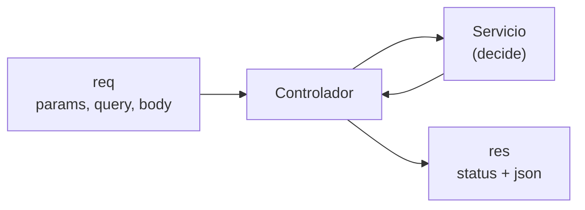

# Controladores

## ¿Qué es un controlador?

El controlador es la capa que **habla HTTP**. Recibe `req` (la petición) y `res` (la respuesta), saca los datos que necesita, llama al servicio y devuelve la respuesta con el código correcto.

Un buen controlador es **delgado**: casi no tiene lógica, solo coordina.

## Anatomía de un controlador

```js
export async function crear(req, res) {
  const nueva = await servicio.crear(crearVideojuegoDto(req.body));
  res.status(201).json({ data: nueva });
}
```

Tres pasos:

1. **Tomar datos de la petición** (`req.body`, `req.params`, `req.query`), limpiados por el DTO.
2. **Llamar al servicio** con esos datos.
3. **Responder** con el código HTTP y el cuerpo adecuados.

## Códigos HTTP que usa el proyecto

| Código | Significado                 | Dónde se usa                                |
| ------ | --------------------------- | ------------------------------------------- |
| `200`  | Todo bien                   | Listar, obtener, actualizar                 |
| `201`  | Recurso creado              | Crear desarrolladora, videojuego, reseña    |
| `204`  | Éxito sin contenido         | Eliminar (no devuelve cuerpo)               |
| `400`  | Datos inválidos             | Lo gestionan validadores y el middleware    |
| `404`  | No encontrado               | Lo lanza el servicio con `HttpError`        |

## Por qué no hay `try/catch`

Cada controlador es `async`. Si el servicio lanza un error, la promesa se rechaza y Express 5 lo envía automáticamente a `manejarError`. Por eso el código queda limpio:

```js
export async function obtener(req, res) {
  const videojuego = await servicio.obtenerPorId(req.params.id);
  res.json({ data: videojuego });
}
```

Si el id no existe, el servicio lanza un 404 y el controlador nunca llega a `res.json`.

## Filtros desde la URL

El controlador de listar traduce los parámetros de la URL en un objeto para el servicio:

```js
const videojuegos = await servicio.listar({
  estado: req.query.estado,
  genero: req.query.genero,
});
```

Si la URL es `/api/v1/videojuegos?estado=jugando`, `req.query.estado` vale `"jugando"` y `req.query.genero` vale `undefined`. El modelo ignora los filtros que no llegan.

## Lo que el controlador NO debe hacer

- Escribir SQL.
- Decidir reglas de negocio (por ejemplo, "un juego completado no puede volver a pendiente").
- Validar datos a mano con `if`: para eso existen los validadores.

## Diagrama de responsabilidades



## Errores comunes

- Olvidar `await` antes del servicio: `res.json` enviaría una promesa en vez de los datos.
- Llamar a `res.json` dos veces: Express lanza el error "headers already sent".
- Usar `res.send` en un 204 con contenido: el 204 no debe tener cuerpo, por eso se usa `res.status(204).end()`.

## Ejercicio

Crea un endpoint `GET /api/v1/desarrolladoras/:id/videojuegos` en `desarrolladora.controller.js` que devuelva los juegos de una desarrolladora. Pista: reutiliza `servicio.listar` de videojuegos o agrega un método nuevo al modelo con `WHERE desarrolladora_id = ?`.
