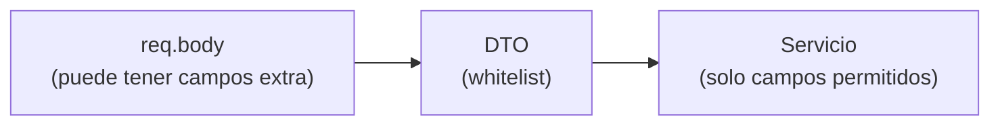

# DTOs (Data Transfer Objects)

## ¿Qué es un DTO?

Un DTO es una función o estructura que define **exactamente qué campos pasan** de una capa a otra. En este proyecto son funciones que reciben `req.body` y devuelven un objeto limpio.

```js
export function crearVideojuegoDto(body) {
  const datos = body ?? {};
  return {
    titulo: datos.titulo,
    plataforma: datos.plataforma,
    genero: datos.genero,
    anio_lanzamiento: datos.anio_lanzamiento,
    estado: datos.estado ?? "pendiente",
    desarrolladora_id: datos.desarrolladora_id ?? null,
  };
}
```

## ¿Para qué sirve si ya hay validadores?

Los validadores revisan que los datos **sean correctos**. El DTO decide **cuáles se aceptan**. Imagina que alguien envía:

```json
{
  "titulo": "Hollow Knight",
  "plataforma": "PC",
  "genero": "Aventura",
  "anio_lanzamiento": 2017,
  "id": 999,
  "creado_por_admin": true
}
```

Los campos `id` y `creado_por_admin` no existen en el DTO, así que **se descartan**. El cliente no puede elegir su propio `id` ni colarse campos que la base de datos no debe recibir. A esto se le llama **whitelist** (lista blanca).

## Crear vs actualizar

Hay dos DTOs por recurso, igual que en el proyecto original:

| Archivo                          | Comportamiento                                                |
| -------------------------------- | ------------------------------------------------------------- |
| `crear-videojuego.dto.js`        | Devuelve todos los campos, con valores por defecto si faltan  |
| `actualizar-videojuego.dto.js`   | Solo incluye los campos que llegaron (`!== undefined`)        |

```js
for (const campo of CAMPOS) {
  if (datos[campo] !== undefined) {
    dto[campo] = datos[campo];
  }
}
```

Esto permite que un `PATCH` con `{"estado": "completado"}` cambie solo el estado y no toque el resto.

## ¿Por qué `body ?? {}`?

En Express 5, `req.body` puede ser `undefined` si la petición no tiene cuerpo. Escribir `body.nombre` sobre `undefined` lanza un error. Con `body ?? {}` garantizamos un objeto vacío como respaldo.

## Diagrama



## Errores comunes

- Pasar `req.body` directamente al modelo: cualquier campo enviado llegaría a la base de datos.
- Olvidar agregar un campo nuevo al DTO: el campo se ignora en silencio. Si algo "no se guarda", revisa el DTO primero.
- Mantener campos en el DTO que no existen en la tabla: el modelo fallará con un error de SQL.

## Ejercicio

Agrega un campo `url_portada` al `crear-desarrolladora.dto.js` y observa que, sin cambiar el modelo ni la base de datos, el campo sigue sin guardarse. Luego analiza por qué: ¿en qué capa se descartó?
