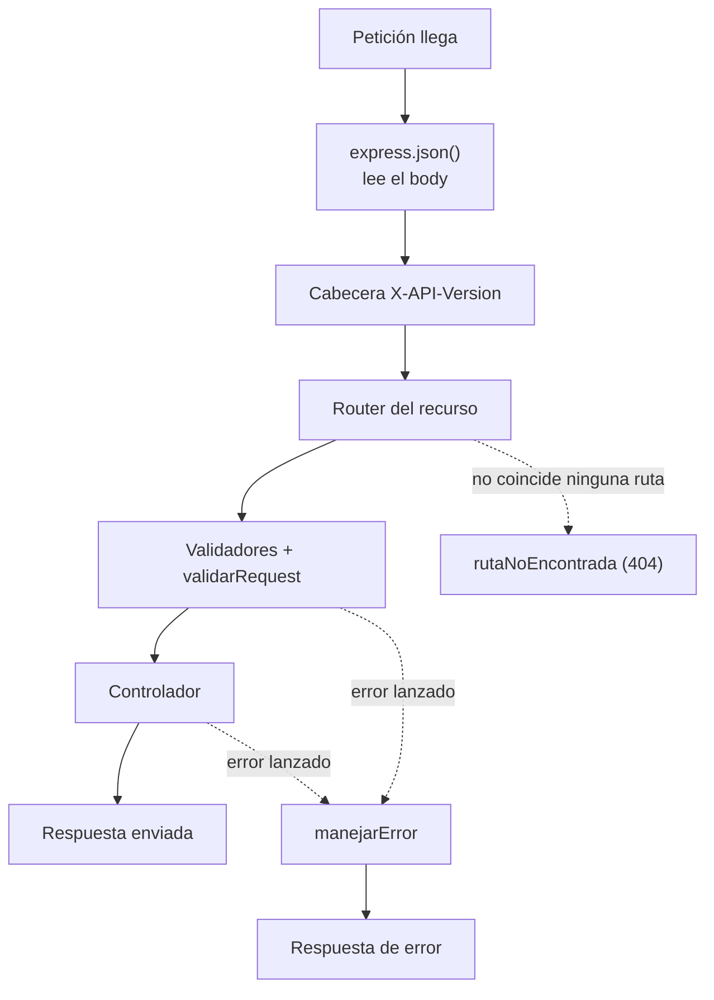
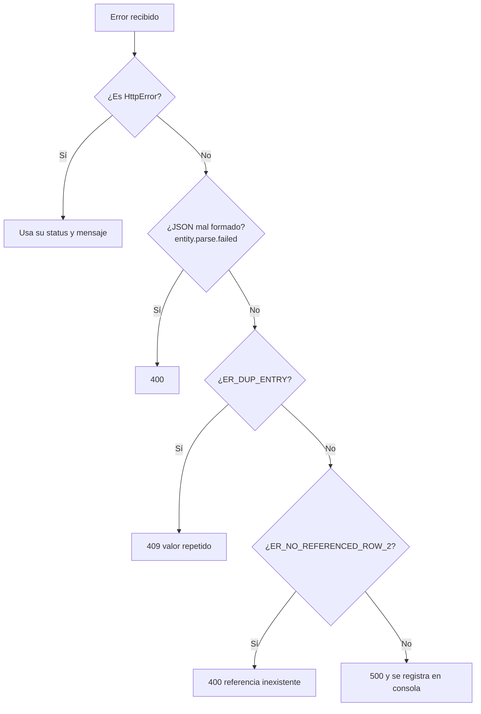

# Middlewares

## ¿Qué es un middleware?

Un middleware es una función que recibe tres argumentos:

```js
function miMiddleware(req, res, next) {
  // 1. Puede leer o modificar req (la petición)
  // 2. Puede responder con res (la respuesta)
  // 3. Debe llamar a next() para pasar a la siguiente función
}
```

Son como **filtros en una fila de seguridad del aeropuerto**: cada filtro revisa algo y te deja pasar al siguiente, o te detiene si algo no está bien.

## Tipos de middlewares en el proyecto

| Tipo                  | Ejemplo                                   | Dónde se define           |
| --------------------- | ----------------------------------------- | ------------------------- |
| Globales              | `express.json()`, cabecera `X-API-Version` | `app.js`                  |
| De validación         | `validarRequest`                          | `middlewares/`, en cada ruta |
| De validación de datos | `crearVideojuegoValidator`               | `validators/`, en cada ruta |
| Rutas no encontradas  | `rutaNoEncontrada`                        | `middlewares/error.middleware.js` |
| Manejo de errores     | `manejarError`                            | `middlewares/error.middleware.js` |

## Orden de ejecución



Express ejecuta los middlewares **en el orden en que se registran**. Por eso `manejarError` va siempre al final de `app.js`.

## `validarRequest`: el guardia de validación

```js
export function validarRequest(req, res, next) {
  const resultado = validationResult(req);
  if (resultado.isEmpty()) {
    return next();
  }
  return res.status(400).json({ errores: resultado.array() });
}
```

Los validadores (`body`, `param`, `query`) **no detienen** la petición por sí solos: solo guardan los errores en `req`. `validarRequest` es quien lee esos errores y decide:

- Si no hay errores, llama a `next()` y la petición sigue.
- Si hay errores, responde `400` sin llegar al controlador.

## `HttpError`: un error con código HTTP

```js
export class HttpError extends Error {
  constructor(status, mensaje) {
    super(mensaje);
    this.status = status;
  }
}
```

Los servicios lanzan `throw new HttpError(404, "Videojuego no encontrado")`. No conocen Express, pero sí saben qué código HTTP corresponde. El middleware de errores lo traduce a una respuesta.

## `manejarError`: el middleware de errores

Un middleware de errores se reconoce porque tiene **cuatro parámetros**: `(error, req, res, next)`. Express solo lo ejecuta cuando alguna función anterior lanza un error o llama a `next(error)`.



Puntos importantes:

- Al cliente **nunca** se le muestra el error técnico de MySQL; solo un mensaje genérico. Así no se filtra información interna.
- El error completo sí se imprime en consola con `console.error`, para que el desarrollador lo vea.
- `if (res.headersSent) return next(error);` evita intentar responder dos veces.

## Errores comunes

- Olvidar `next()` en un middleware normal: la petición se queda colgada sin respuesta.
- Llamar a `next()` después de haber respondido con `res.json()`: produce el error "headers already sent".
- Definir `manejarError` con tres parámetros: Express no lo reconoce como middleware de errores.

## Ejercicio

Crea un middleware `registrarPeticion` que imprima en consola el método y la URL de cada petición, y regístralo en `app.js` justo después de `express.json()`. Pruébalo con `curl` y observa la salida.
