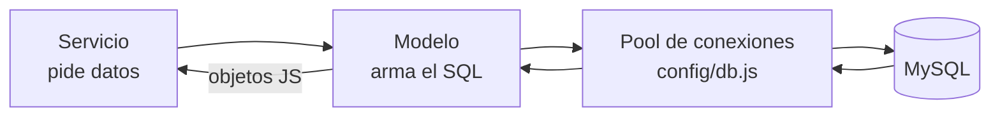

# Modelos: acceso a la base de datos

## ¿Qué es un modelo?

El modelo es la única capa que **habla SQL**. Su trabajo es traducir una operación ("buscar un videojuego por id") en una consulta a MySQL y devolver las filas como objetos de JavaScript.

Los modelos no contienen reglas de negocio ni conocen HTTP. Son como la **despensa**: guardan y entregan ingredientes, pero no deciden el menú.

## Ejecutar una consulta

```js
const [filas] = await db.execute(
  "SELECT id, titulo FROM videojuegos WHERE id = ?",
  [id]
);
```

- `db.execute` envía la consulta a MySQL usando el pool de conexiones.
- El `?` es un **placeholder**: MySQL reemplaza el signo por el valor del array.
- `db.execute` devuelve un array `[filas, metadatos]`. Con `const [filas]` guardamos solo las filas.

## ¿Por qué usar `?` y no concatenar?

Esto es peligroso:

```js
// ❌ NUNCA hagas esto
db.execute(`SELECT * FROM videojuegos WHERE titulo = '${titulo}'`);
```

Si alguien envía como título `' OR '1'='1`, la consulta cambia de significado y puede exponer toda la tabla. Esto se llama **inyección SQL**. Con placeholders, MySQL trata el valor como dato, nunca como código SQL.

## Listas blancas de columnas

En `update` los nombres de las columnas se construyen dinámicamente:

```js
const claves = Object.keys(campos).filter((c) => CAMPOS_PERMITIDOS.includes(c));
const asignaciones = claves.map((c) => `${c} = ?`).join(", ");
```

Los **valores** van con `?`, pero los **nombres de columna** no pueden ser placeholders. Por eso se filtran contra `CAMPOS_PERMITIDOS`. Así, aunque el DTO fallara, nadie podría escribir en una columna que no esté en la lista.

## Consultas dinámicas con filtros

```js
let sql = `${SELECT_LISTA} WHERE 1 = 1`;
if (estado) {
  sql += " AND v.estado = ?";
  params.push(estado);
}
```

`WHERE 1 = 1` es un truco: siempre es verdadero, así que cada filtro se puede añadir con `AND` sin preocuparse de si es el primero. Los valores siguen entrando por `params`.

## JOIN: unir tablas

```sql
SELECT v.titulo, d.nombre AS desarrolladora
FROM videojuegos v
LEFT JOIN desarrolladoras d ON d.id = v.desarrolladora_id;
```

- `LEFT JOIN` conserva todos los videojuegos aunque no tengan desarrolladora.
- `INNER JOIN` (usado en reseñas) solo devuelve filas que tengan pareja en ambas tablas.

## Subconsultas y agregados

En `findById` calculamos la calificación promedio sin una consulta extra:

```sql
(SELECT ROUND(AVG(r.calificacion), 1)
   FROM resenas r WHERE r.videojuego_id = v.id) AS calificacion_promedio
```

Es una subconsulta que se ejecuta por cada videojuego. Para pocos datos es perfectamente válida; con millones de filas se usaría un `GROUP BY` o una vista.

## Resultados de escritura

| Operación | Qué devuelve                  | Uso en el proyecto                         |
| --------- | ----------------------------- | ------------------------------------------ |
| `INSERT`  | `insertId`: el id nuevo       | Se usa para leer el registro completo      |
| `UPDATE`  | `affectedRows`: filas cambiadas | Si es 0, el registro no existía          |
| `DELETE`  | `affectedRows`: filas borradas | Igual que en UPDATE                       |
| `SELECT`  | Array de filas (o vacío)       | `filas[0] ?? null` para devolver uno o nada |

## Diagrama



## Errores comunes

- Concatenar valores en la consulta en lugar de usar `?`.
- Olvidar el array de parámetros: MySQL recibe `?` sin valor y falla.
- Confundir `filas` con `filas[0]`: `findAll` devuelve un array; `findById` devuelve un objeto o `null`.

## Ejercicio

Crea en `desarrolladora.model.js` una función `countVideojuegos(id)` que devuelva cuántos juegos tiene una desarrolladora usando `SELECT COUNT(*)`. Luego úsala en un endpoint `GET /api/v1/desarrolladoras/:id/estadisticas`.
