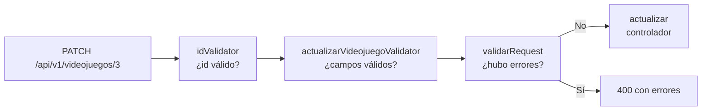

# Rutas

## ¿Qué es una ruta?

Una ruta conecta **un método HTTP y una URL** con **una función del código**. Por ejemplo:

```js
router.post("/", crearResenaValidator, validarRequest, ctrl.crear);
```

Se lee así: "cuando llegue una petición `POST` a la raíz de este recurso, revisa los datos con `crearResenaValidator`, confirma que no hubo errores con `validarRequest` y finalmente ejecuta `ctrl.crear`".

## ¿Qué es un Router?

`Router()` de Express es un mini-servidor de rutas que se puede montar dentro de la aplicación principal. Cada recurso tiene el suyo, lo que mantiene las rutas agrupadas y fáciles de encontrar.

En `app.js` se monta con un prefijo:

```js
app.use("/api/v1/videojuegos", videojuegoRouter);
```

Así, `router.get("/:id", ...)` dentro del archivo se convierte en `GET /api/v1/videojuegos/:id`.

## Tabla de endpoints por recurso

| Método   | Ruta relativa  | Cadena de funciones                                              | Acción       |
| -------- | -------------- | ---------------------------------------------------------------- | ------------ |
| `GET`    | `/`            | filtros → validarRequest → listar                                | Listar       |
| `GET`    | `/:id`         | idValidator → validarRequest → obtener                           | Obtener      |
| `POST`   | `/`            | reglas de creación → validarRequest → crear                      | Crear        |
| `PATCH`  | `/:id`         | idValidator → reglas de actualización → validarRequest → actualizar | Actualizar |
| `DELETE` | `/:id`         | idValidator → validarRequest → eliminar                          | Eliminar     |

## Anatomía de una cadena de rutas



Cada función recibe la petición, hace su trabajo y llama a `next()` para pasar a la siguiente. Si una de ellas responde (por ejemplo, con un 400), la cadena se detiene ahí.

## Parámetros de ruta

`:id` es un **parámetro**. Si haces `GET /api/v1/videojuegos/3`, Express guarda `"3"` en `req.params.id`. Como siempre llega como texto, el validador `idValidator` lo comprueba y lo convierte a número con `.toInt()`.

## El orden de las rutas

Express evalúa las rutas de arriba a abajo. Las rutas fijas (como `/health`) deben escribirse antes que las dinámicas si pueden coincidir. En este proyecto `/` y `/:id` no chocan porque no coinciden con la misma URL.

## Errores comunes

- Olvidar `validarRequest` después de los validadores: las reglas se ejecutan, pero nadie revisa el resultado, así que datos inválidos llegarían al controlador.
- Poner el middleware en el orden incorrecto: si `validarRequest` va antes de los validadores, siempre dice "todo bien".
- Escribir la ruta completa dentro del router: sería `/api/v1/videojuegos/...` duplicado.

## Ejercicio

Agrega en `videojuego.routes.js` una ruta `GET /destacados` que devuelva solo los juegos con estado `completado`. Pista: llama a `ctrl.listar` pasando el estado en `req.query`, o crea una función nueva en el controlador.
