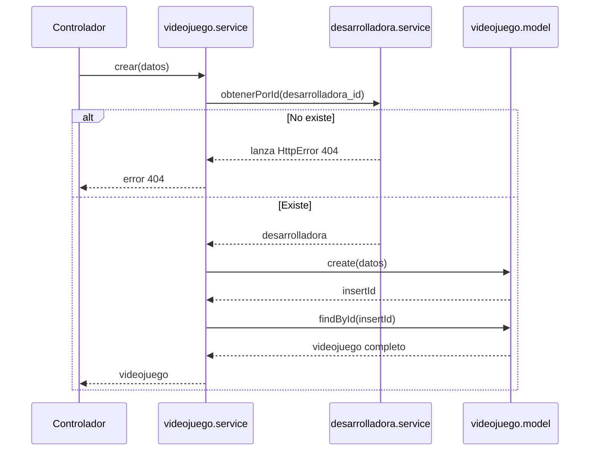

# Servicios

## ¿Qué es un servicio?

El servicio es el **cerebro** de la aplicación. Aquí viven las reglas de negocio: qué se puede hacer, en qué orden y qué pasa si algo no cumple las condiciones.

El servicio **no conoce HTTP**. No recibe `req` ni `res`, no sabe qué es un cliente ni un código de estado. Solo recibe datos y devuelve datos (o lanza errores). Esto lo hace reutilizable: el mismo servicio podría usarse desde una API, un script o una tarea programada.

## Anatomía de un servicio

```js
export async function obtenerPorId(id) {
  const videojuego = await modelo.findById(id);
  if (!videojuego) {
    throw new HttpError(404, "Videojuego no encontrado");
  }
  return videojuego;
}
```

Un servicio suele:

1. Pedir datos al modelo.
2. Comprobar reglas.
3. Hacer cambios a través del modelo.
4. Devolver el resultado o lanzar un error.

## `HttpError`: errores con significado

El servicio lanza `HttpError` con el código HTTP correspondiente, pero sin saber cómo se enviará. El middleware `manejarError` se encarga de convertirlo en respuesta JSON.

Es un punto medio útil: el servicio sabe **qué** pasó (no encontrado), y la capa HTTP decide **cómo** mostrarlo.

## Reglas de negocio entre recursos

Un videojuego puede tener una desarrolladora. Antes de guardar, el servicio comprueba que exista:

```js
async function verificarDesarrolladora(desarrolladoraId) {
  if (desarrolladoraId !== undefined && desarrolladoraId !== null) {
    await desarrolladoraServicio.obtenerPorId(desarrolladoraId);
  }
}
```

Observa cómo `videojuego.service.js` **importa** `desarrolladora.service.js`. Un servicio puede usar a otro, siempre que no formen un ciclo (A usa a B y B usa a A).

Esta verificación da un mensaje claro (`404 Desarrolladora no encontrada`). Sin ella, MySQL devolvería un error técnico de clave foránea.

## Flujo de crear un videojuego



## ¿Por qué `crear` devuelve `obtenerPorId`?

El `INSERT` solo devuelve el `id` nuevo. Para responder con los datos completos (incluido el nombre de la desarrolladora por el `JOIN`), el servicio vuelve a leer el registro. Es un patrón muy común: **escribir y luego leer lo que se acaba de guardar**.

## Patrón de la capa de servicios

Cada operación de escritura sigue el mismo esquema:

```js
export async function actualizar(id, cambios) {
  await obtenerPorId(id);        // 1. ¿Existe?
  await verificarDesarrolladora(cambios.desarrolladora_id); // 2. ¿Reglas?
  await modelo.update(id, cambios); // 3. Escribir
  return obtenerPorId(id);       // 4. Devolver el estado actual
}
```

## Errores comunes

- Poner `req` o `res` en un servicio: rompe la separación de capas.
- Escribir SQL directamente en el servicio: esa responsabilidad es del modelo.
- Crear dependencias circulares entre servicios (A ↔ B), que pueden causar errores al cargar módulos.

## Ejercicio

Añade una regla de negocio: "un videojuego con estado `pendiente` no puede tener reseñas". Impleméntala en `resena.service.js` dentro de `crear`, consultando el estado del juego antes de insertar. Lanza un `HttpError` con código `409`.
